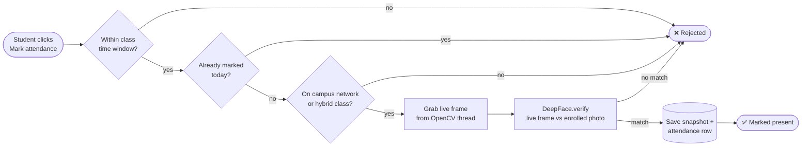
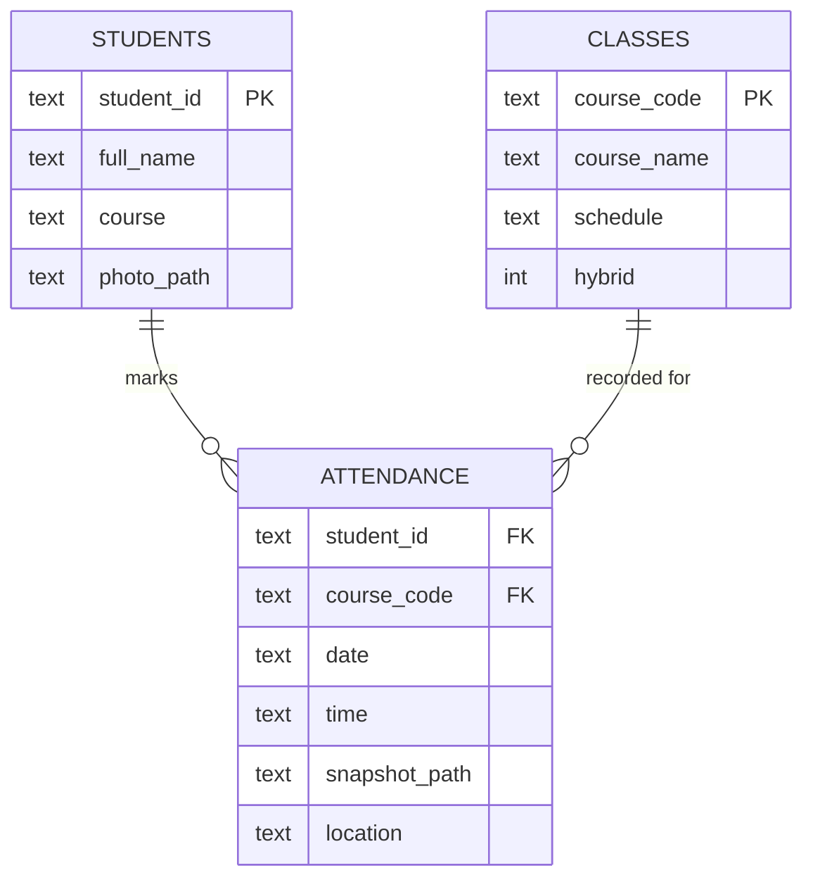

<p align="center">
  
</p>

<p align="center">
  
  
  
  
  
</p>

<p align="center">
  No roll calls, no sign-in sheets. Students look at a camera and AttendAI does the rest.
</p>

---

## ✨ What it does

<table>
  <tr>
    <td width="50%" valign="top">
      <h3>👩‍🏫 Lecturer portal</h3>
      <ul>
        <li>Enroll students with a reference photo</li>
        <li>Manage classes, schedules and hybrid mode</li>
        <li>Run live recognition sessions</li>
        <li>Audit log of every scan, with the captured snapshot</li>
      </ul>
    </td>
    <td width="50%" valign="top">
      <h3>🎓 Student portal</h3>
      <ul>
        <li>Log in with a student ID</li>
        <li>Start the webcam and mark attendance by face</li>
        <li>Instant success or error feedback</li>
        <li>View your own attendance record</li>
      </ul>
    </td>
  </tr>
</table>

### 🛡️ Anti-cheating rules

| | Rule | How it works |
|:-:|---|---|
| ⏱️ | **Time window** | Attendance only opens 15 minutes either side of the scheduled class time |
| 🔁 | **Once per day** | A second scan for the same class on the same day is rejected |
| 📍 | **On campus** | The client IP must be on the campus network. Hybrid classes allow remote scans, tagged `remote`. |
| 📸 | **Proof** | Every successful match saves a timestamped snapshot for the lecturer's audit log |

---

## ⚙️ How it works



- **Face verification** uses DeepFace. It runs in a separate subprocess (`recognize.py`) so the TensorFlow model stays isolated from the Flask request thread.
- **Camera capture** runs on a background thread with a lock around the latest frame, so the live feed and recognition requests don't block each other.
- **Data** lives in SQLite across three tables: `students`, `classes` and `attendance`.



---

## 🎨 UI design

Early wireframes for the main screens:

<table>
  <tr>
    <td align="center"><br/><sub>Lecturer dashboard</sub></td>
    <td align="center"><br/><sub>Enroll a student</sub></td>
  </tr>
  <tr>
    <td align="center"><br/><sub>Student self-scan</sub></td>
    <td align="center"><br/><sub>Attendance confirmed</sub></td>
  </tr>
</table>

---

## 🧰 Tech stack

| Layer | Tools |
|---|---|
| **Backend** | Python, Flask, Gunicorn |
| **Computer vision** | DeepFace, OpenCV (headless), TensorFlow / Keras, MTCNN, RetinaFace |
| **Database** | SQLite |
| **Frontend** | Jinja templates, HTML, CSS, vanilla JavaScript |
| **Deployment** | Nixpacks config for the X11 libraries OpenCV needs |

---

## 🚀 Run it locally

```bash
git clone https://github.com/Divansshi/face-attendance-system.git
cd face-attendance-system
python3.10 -m venv venv
source venv/bin/activate
pip install -r requirements.txt
python app.py
```

Then open **http://localhost:5001**.

<details>
<summary><b>⚙️ Configuration</b></summary>

<br/>

| Variable | Purpose | Default |
|---|---|---|
| `SECRET_KEY` | Flask session signing key | `dev-only-change-me` |
| `LECTURER_EMAIL` | Lecturer login email | `amirah@university.edu` |
| `LECTURER_PASSWORD` | Lecturer login password | `password` |

In `security.py`, set `CAMPUS_IP_PREFIX` to your network's IP range. For development, set `TESTING_TIME` and `TESTING_LOCATION` to `True` to bypass the time and location checks.

Enrolled photos and snapshots are written to `static/photos/` and `static/snapshots/`. Both are git-ignored, so biometric data never gets committed.

</details>

<details>
<summary><b>📁 Project structure</b></summary>

<br/>

```
app.py          Flask routes for the lecturer, student and camera endpoints
camera.py       Threaded OpenCV capture
recognize.py    DeepFace verification, run as a subprocess
security.py     Time-window, duplicate and location rules
database.py     SQLite schema and seed classes
templates/      Lecturer and student pages
docs/           Planning notes and UI wireframes
```

</details>

---

## 🔭 What's next

- [ ] Liveness detection, so a printed photo can't pass
- [ ] Threshold tuning for lookalikes
- [ ] Browser-side camera capture (right now the webcam must be on the machine running the app)
- [ ] Multi-class support in the student scan flow
- [ ] Real lecturer accounts with hashed passwords
- [ ] CSV export of attendance records

---

<p align="center">
  Built by <b>Divansshi Mukunthan</b><br/>
  <a href="https://www.linkedin.com/in/divansshiii">LinkedIn</a> · <a href="https://github.com/Divansshi">GitHub</a>
</p>

<p align="center">
  
</p>
