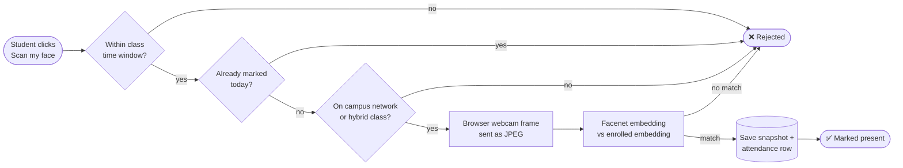
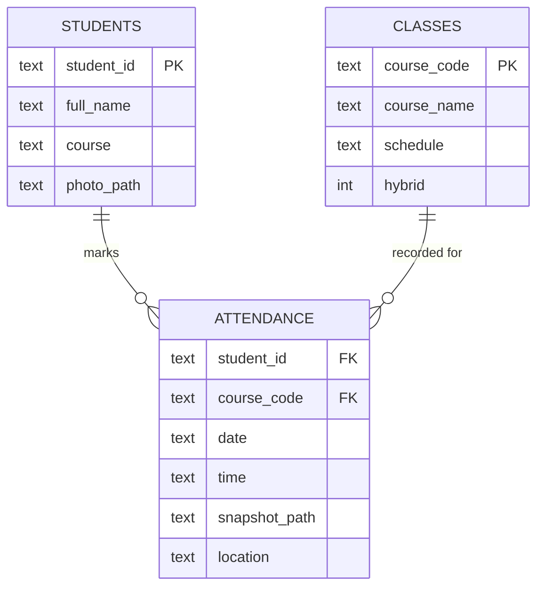
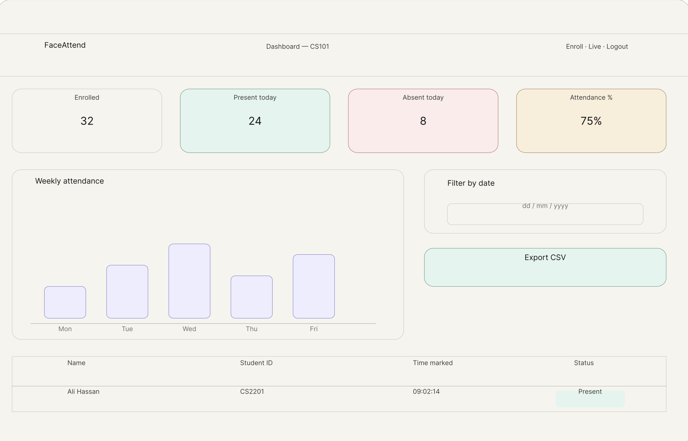
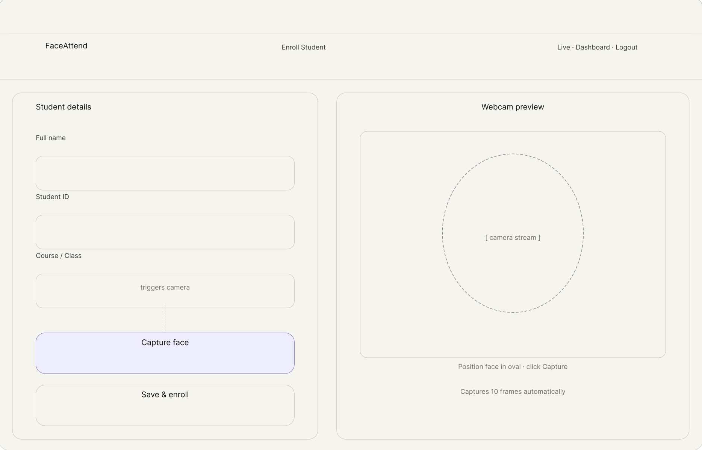
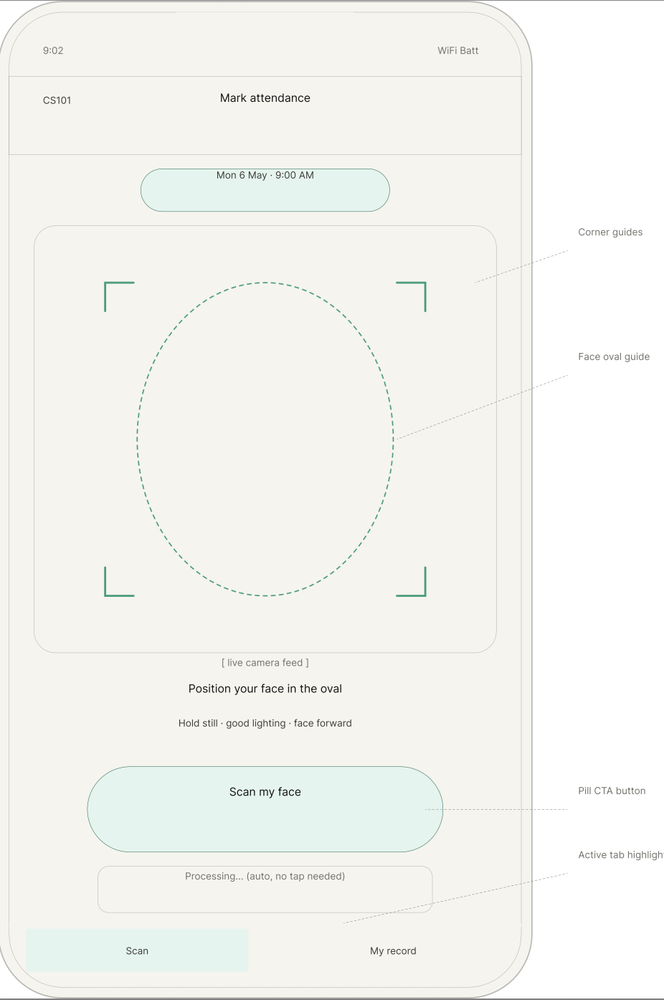
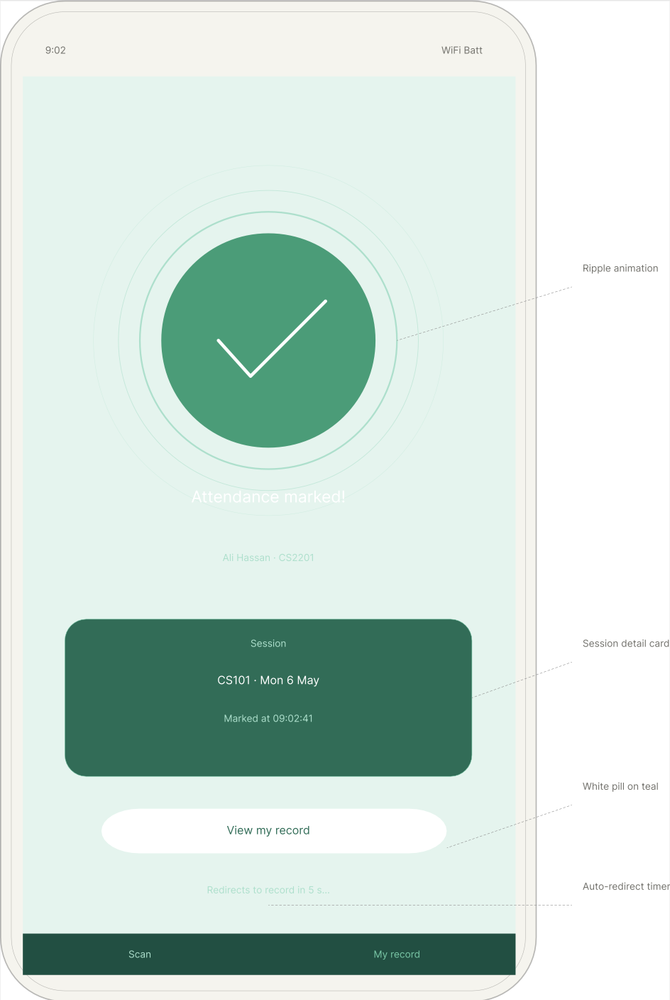
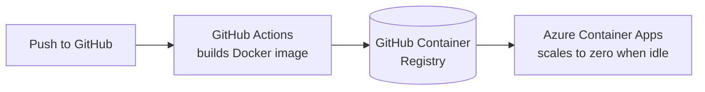

<p align="center">
  
</p>

<p align="center">
  
  
  
  
  
</p>

<p align="center">
  No roll calls, no sign-in sheets. Students look at a camera and AttendAI does the rest.
</p>

---

## ✨ What it does

<table>
  <tr>
    <td width="50%" valign="top">
      <h3>👩‍🏫 Lecturer portal</h3>
      <ul>
        <li>Enroll students with a reference photo</li>
        <li>Manage classes, schedules and hybrid mode</li>
        <li>Run live recognition sessions</li>
        <li>Audit log of every scan, with the captured snapshot</li>
      </ul>
    </td>
    <td width="50%" valign="top">
      <h3>🎓 Student portal</h3>
      <ul>
        <li>Log in with a student ID</li>
        <li>Start the webcam and mark attendance by face</li>
        <li>Instant success or error feedback</li>
        <li>View your own attendance record</li>
      </ul>
    </td>
  </tr>
</table>

### 🛡️ Anti-cheating rules

| | Rule | How it works |
|:-:|---|---|
| ⏱️ | **Time window** | Attendance only opens 15 minutes either side of the scheduled class time |
| 🔁 | **Once per day** | A second scan for the same class on the same day is rejected |
| 📍 | **On campus** | The client IP must be on the campus network. Hybrid classes allow remote scans, tagged `remote`. |
| 📸 | **Proof** | Every successful match saves a timestamped snapshot for the lecturer's audit log |

---

## ⚙️ How it works



- **Camera capture happens in the browser.** The page uses the visitor's own webcam through `getUserMedia` and sends a single JPEG frame per scan, so the server never needs a camera of its own.
- **Face verification** uses DeepFace with the Facenet model and cosine distance. The model loads once when the server starts, and each enrolled photo's embedding is computed once and cached. A scan only embeds the live frame and compares it.
- **Lecturer live sessions** embed the frame once and pick the closest enrolled student under the threshold, rather than re-checking every student from scratch.
- **Enrollment checks for a face** before saving, and photos can be uploaded or taken with the webcam.
- **Data** lives in SQLite across three tables: `students`, `classes` and `attendance`.



---

## 🎨 UI design

Early wireframes for the main screens:

<table>
  <tr>
    <td align="center"><br/><sub>Lecturer dashboard</sub></td>
    <td align="center"><br/><sub>Enroll a student</sub></td>
  </tr>
  <tr>
    <td align="center"><br/><sub>Student self-scan</sub></td>
    <td align="center"><br/><sub>Attendance confirmed</sub></td>
  </tr>
</table>

---

## 🧰 Tech stack

| Layer | Tools |
|---|---|
| **Backend** | Python, Flask, Gunicorn |
| **Computer vision** | DeepFace (Facenet), OpenCV (headless), TensorFlow / Keras |
| **Database** | SQLite |
| **Frontend** | Jinja templates, HTML, CSS, vanilla JavaScript, WebRTC `getUserMedia` |
| **Deployment** | Docker, GitHub Actions, Azure Container Apps, Gunicorn |

---

## 🚀 Run it locally

```bash
git clone https://github.com/Divansshi/face-attendance-system.git
cd face-attendance-system
python3.11 -m venv venv
source venv/bin/activate
pip install -r requirements.txt
pip install --no-deps -r requirements-nodeps.txt
DEMO_MODE=1 python app.py
```

Then open **http://localhost:5001**. The first start downloads the Facenet weights (about 90 MB).

## ☁️ Deployment



Every push to `main` builds the image with GitHub Actions (`.github/workflows/container.yml`) and publishes it to `ghcr.io/divansshi/face-attendance-system`. Azure Container Apps runs that image:

```bash
az containerapp up \
  --name attendai \
  --resource-group attendai-rg \
  --location southeastasia \
  --image ghcr.io/divansshi/face-attendance-system:latest \
  --ingress external --target-port 8080 \
  --env-vars DEMO_MODE=1 SECRET_KEY=<random-string>
```

The app runs with 1 vCPU and 2 GiB of memory, scales to zero when nobody is using it, and is capped at one replica so every visitor shares the same SQLite database. The container's disk is temporary, so enrolled students reset whenever the app restarts, which suits a public demo.

<details>
<summary><b>⚙️ Configuration</b></summary>

<br/>

| Variable | Purpose | Default |
|---|---|---|
| `DEMO_MODE` | Relaxes the time-window and campus checks and shows demo hints | off |
| `SECRET_KEY` | Flask session signing key | `dev-only-change-me` |
| `LECTURER_EMAIL` | Lecturer login email | `amirah@university.edu` |
| `LECTURER_PASSWORD` | Lecturer login password | `password` |

| `CAMPUS_IP_PREFIX` | IP range counted as on campus | `192.168.` |
| `TESTING_TIME` / `TESTING_LOCATION` | Bypass just one of the two checks | off |
| `FACE_MODEL` / `FACE_THRESHOLD` | DeepFace model and match threshold | `Facenet` / DeepFace default |

Enrolled photos and snapshots are written to `static/photos/` and `static/snapshots/`. Both are git-ignored, so biometric data never gets committed.

</details>

<details>
<summary><b>📁 Project structure</b></summary>

<br/>

```
app.py              Flask routes for the lecturer and student portals
face_engine.py      Model loading, embedding cache, verify and identify
security.py         Time-window, duplicate and location rules
database.py         SQLite schema and seed classes
static/camera.js    Browser webcam capture
templates/          Lecturer and student pages
Dockerfile          Container image
.github/workflows/  Image build on every push
docs/               Planning notes and UI wireframes
```

</details>

---

## 🔭 What's next

- [ ] Liveness detection, so a printed photo can't pass
- [ ] Threshold tuning for lookalikes
- [x] Browser-side camera capture
- [ ] Persistent storage (a managed database and blob storage) instead of SQLite on a temporary disk
- [ ] Class picker in the lecturer live session (currently fixed to CS301)
- [ ] Real lecturer accounts with hashed passwords
- [ ] CSV export of attendance records

---

<p align="center">
  Built by <b>Divansshi Mukunthan</b><br/>
  <a href="https://www.linkedin.com/in/divansshiii">LinkedIn</a> · <a href="https://github.com/Divansshi">GitHub</a>
</p>

<p align="center">
  
</p>
